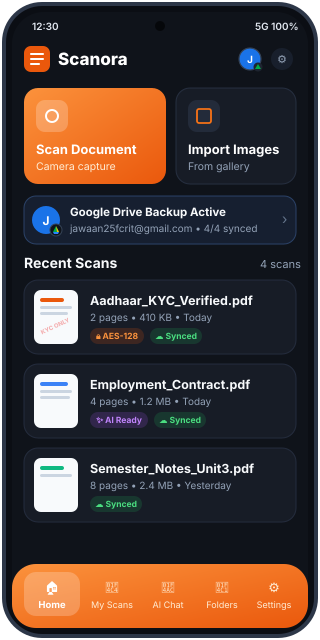
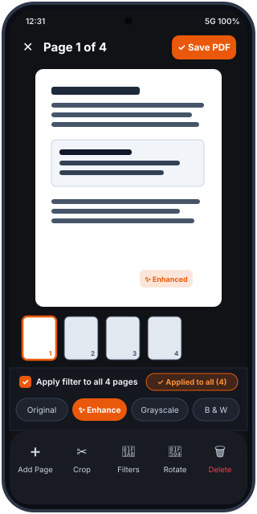
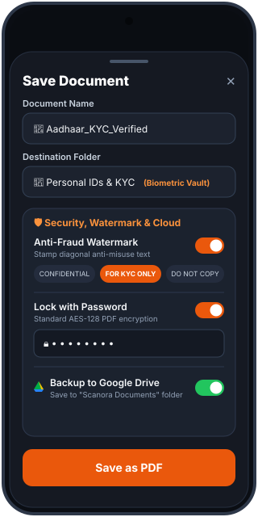
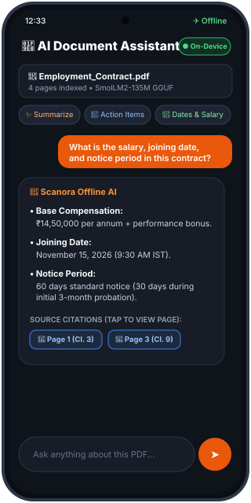
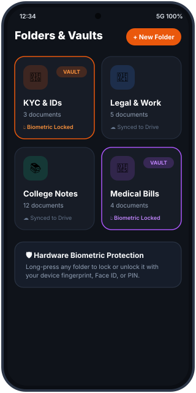
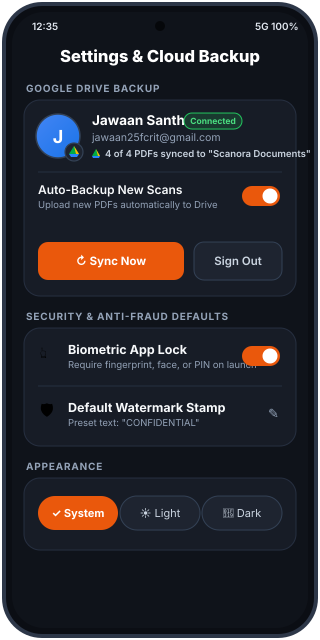
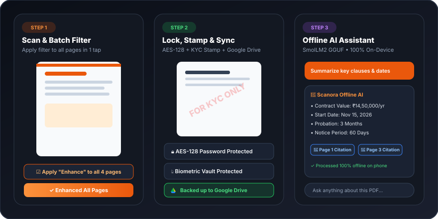
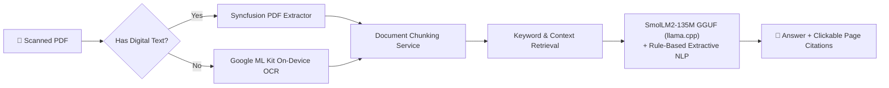
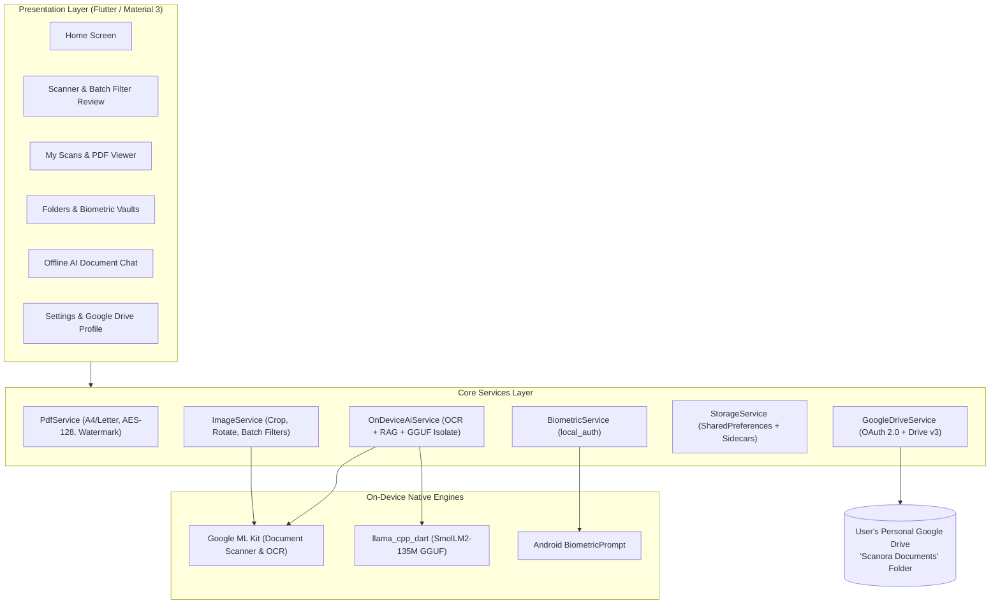

<div align="center">


<br/>

<a href="https://github.com/jawaanquizziz/Scanora">
  
</a>

<br/>

[](https://flutter.dev)
[](https://dart.dev)
[](#-installation)
[](#-on-device-ai-document-assistant)
[](#%EF%B8%8F-google-drive-cloud-backup)
[](#-installation)
[](LICENSE)

**[Overview](#-overview) • [Key Features](#-key-features) • [App Screens](#-app-screens) • [Google Drive Sync](#%EF%B8%8F-google-drive-cloud-backup) • [Architecture](#%EF%B8%8F-architecture) • [Tech Stack](#-tech-stack) • [Installation](#-installation)**

</div>

---

## 📖 Overview

**Scanora** is a privacy-first Android document scanner and offline AI document assistant built with **Flutter**.

Most mobile scanners lock clean exports, batch filters, and PDF encryption behind subscriptions, while cloud "Chat with PDF" tools upload sensitive personal files—such as government IDs, KYC forms, contracts, and bank statements—to external servers. **Scanora keeps the entire pipeline on your device**: camera edge detection, perspective cropping, batch image enhancement, OCR, AES-128 PDF password protection, anti-fraud watermarking, and local GGUF LLM inference all execute offline on the phone. When cloud backup is enabled, documents sync directly to a `"Scanora Documents"` folder inside **your own Google Drive**.

<div align="center">
  
</div>

---

## ✨ Key Features

<table>
<tr>
<td width="50%" valign="top">

### 📷 Multi-Page Scanning & Batch Filters
- **Automatic Edge Detection:** Powered by Google ML Kit Document Scanner with manual 4-point perspective crop.
- **Apply Filter to All Pages:** Preview **Original**, **Enhance**, **Grayscale**, or **B&W** on one page and apply it across all scanned pages in a single tap.
- **Standard PDF Export:** Generates crisp **A4** or **US Letter** PDFs with automatic cover thumbnails.

</td>
<td width="50%" valign="top">

### 🧠 100% Offline AI Document Assistant
- **Local GGUF Inference:** Runs **SmolLM2-135M Instruct (`Q4_K_M`)** on-device via `llama_cpp_dart` in a background isolate, paired with a fast rule-based NLP engine.
- **Hybrid Text Extraction:** Reads digital PDF text via Syncfusion PDF and falls back to on-device **ML Kit OCR** for camera scans.
- **Page-Level Citations:** Summarizes documents, extracts dates/amounts/action items, and links answers directly to source pages.

</td>
</tr>
<tr>
<td width="50%" valign="top">

### 🔐 Triple-Layer Document Security
- **AES-128 PDF Password Lock:** Standard cryptographic password protection (separate user and owner keys) that stays locked when shared over WhatsApp, Email, or Drive.
- **Anti-Fraud Diagonal Watermarking:** Stamp `CONFIDENTIAL`, `FOR KYC ONLY`, `DO NOT COPY`, `DRAFT`, or custom text across every page to prevent ID/KYC misuse.
- **Biometric App & Vault Lock:** Protect the app and individual Vault folders using fingerprint, face unlock, or device PIN (`local_auth`).

</td>
<td width="50%" valign="top">

###  Personal Google Drive Backup
- **Google Account Integration:** Sign in with Google to display your connected Google profile picture, email, and live sync status.
- **Direct User-Owned Storage:** Uploads PDFs via **Google Drive REST API v3** into `"Scanora Documents"` in your own Google Drive—no third-party servers.
- **Auto-Sync & One-Tap Batch Sync:** Automatically back up newly saved scans or sync all pending documents at once.

</td>
</tr>
</table>

---

## 📱 App Screens

<div align="center">

| Home Dashboard | Multi-Page Review & Batch Filter | Save, Encrypt & Watermark |
|:---:|:---:|:---:|
|  |  |  |
| **Offline AI Document Chat** | **Folders & Biometric Vaults** | **Settings & Google Drive Account** |
|  |  |  |

<br/>

### 🔄 End-to-End Workflow Preview



</div>

---

## ☁️ Google Drive Cloud Backup


Scanora connects directly to **Google Drive REST API v3** using the narrow `drive.file` scope, meaning the app can only access the files it creates inside your **`"Scanora Documents"`** folder and cannot read any other personal files in your Drive.

- **Connected Account Profile:** Displays your Google profile picture, display name, email address, and a real-time counter of backed-up PDFs in **Settings** and the **Home** header.
- **Automatic & Manual Sync:** Toggle **Auto-Backup New Scans** in Settings or during PDF save, or tap **Sync Now** to upload all unsynced documents in a single batch.
- **Preserves Encryption & Watermarks:** Password-locked and watermarked PDFs are uploaded in their encrypted/stamped state.

---

## 🧠 On-Device AI Pipeline



---

## 🏗️ Architecture



<details>
<summary><b>📂 Repository Directory Structure</b></summary>

```text
Scanora/
├── android/                  # Gradle Kotlin DSL, Firebase google-services.json, AndroidManifest
├── docs/
│   ├── readme/               # Animated SVG banner, workflow diagram, Google Drive vector logo
│   └── screenshots/          # App screen renders (home, review, save, chat, folders, settings, demo)
├── lib/
│   ├── main.dart / app.dart  # Entry point & adaptive Material 3 theme setup
│   ├── core/
│   │   ├── theme/            # AppColors, AppTheme (Light & Dark)
│   │   ├── utils/            # Date formatting & file size/name utilities
│   │   └── widgets/          # GoogleDriveLogo, GoogleAccountAvatar, CustomDialogs, Thumbnails
│   ├── features/
│   │   ├── splash/           # Animated launch screen
│   │   ├── shell/            # MainNavigationShell + Biometric lock overlay
│   │   ├── home/             # Quick actions, Drive status banner, recent scans
│   │   ├── scanner/          # Capture, Crop, FilterScreen, PageReviewScreen (Apply to All), SaveDialog
│   │   ├── documents/        # Searchable/sortable PDF library & in-app PDF viewer
│   │   ├── folders/          # Color-coded folders & Biometric Vault locking
│   │   ├── chat/             # Hybrid OCR/PDF extraction, chunking, retrieval, SmolLM2 GGUF isolate
│   │   └── settings/         # Google Drive profile & sync, Biometric lock, Watermark defaults
│   ├── models/               # ScannedDocument, DocumentFolder, ScanPage, AppSettings
│   └── services/             # PdfService, ImageService, GoogleDriveService, BiometricService, StorageService
└── pubspec.yaml
```

</details>

---

## 🧰 Tech Stack

| Category | Technology | Purpose |
| :--- | :--- | :--- |
| **Mobile Framework** | **Flutter 3.x & Dart 3.12** | Cross-platform UI compiled to native ARM64 machine code |
| **On-Device LLM** | **`llama_cpp_dart` + `SmolLM2-135M-Instruct (Q4_K_M GGUF)`** | Offline LLM inference inside a background Dart isolate |
| **Computer Vision & OCR** | **`google_mlkit_document_scanner` & `google_mlkit_text_recognition`** | Edge detection, perspective correction, and offline text recognition |
| **PDF & Cryptography** | **`syncfusion_flutter_pdf`, `pdf`, `printing`** | Multi-page PDF generation, AES-128 password encryption, diagonal watermarks |
| **Image Processing** | **`image` (`^4.12.0`) & `image_picker`** | Batch filters (Enhance, Grayscale, B&W), cropping, rotation, thumbnails |
| **Biometric Security** | **`local_auth` (`^3.0.2`)** | Fingerprint, Face Unlock, and PIN protection for app & vault folders |
| **Cloud & Auth** | **`google_sign_in`, Firebase Auth, Google Drive REST API v3 (`http`)** | Google account profile & direct PDF backup to `"Scanora Documents"` |
| **Persistence** | **`shared_preferences` & `path_provider`** | Local document metadata, folder state, and chat history |

---

## ⚡ Installation

### Option 1 — Install the Prebuilt Release APK (~20 MB)

1. Download **`Scanora-Release.apk`** from the repository root or the [**Releases**](https://github.com/jawaanquizziz/Scanora/releases) tab.
2. Transfer it to your Android device and open it to install.

### Option 2 — Build from Source

```bash
# 1. Clone the repository
git clone https://github.com/jawaanquizziz/Scanora.git
cd Scanora

# 2. Install Flutter dependencies
flutter pub get

# 3. Run in debug mode on a connected device
flutter run

# 4. Build optimized split-ABI release APKs (~20 MB)
flutter build apk --release --split-per-abi
```

---

## 🆚 Comparison with Existing Solutions

| Capability | Traditional Scanner Apps | Cloud "Chat with PDF" Tools | **Scanora** |
| :--- | :---: | :---: | :---: |
| **Clean PDFs (No Brand Watermarks)** | ❌ Paid | — | ✅ **100% Free** |
| **Apply Filter to All Pages (Batch)** | 💰 Paid Pro | — | ✅ **Built-in (1-Tap)** |
| **AI Summarization & Document Q&A** | 💰 Cloud Subscription | ☁️ Uploads Private PDFs | ✅ **100% Offline On-Device** |
| **AES-128 PDF Password Encryption** | 💰 Paid Pro | ❌ | ✅ **Built-in** |
| **Anti-Fraud KYC Diagonal Watermarks** | 💰 Paid Pro | ❌ | ✅ **Presets + Custom Text** |
| **Biometric App & Folder Vault** | Limited | ❌ | ✅ **Fingerprint / Face / PIN** |
| **Cloud Backup Destination** | Vendor Cloud | Vendor Server | ✅ **User's Own Google Drive** |

---

## 🚀 Future Scope

- [ ] **Multi-Language & Handwritten OCR:** Add Devanagari (Hindi/Marathi), Tamil, Telugu, and handwriting recognition models.
- [ ] **Digital Signatures & Form Filling:** Draw or import cryptographic e-signatures directly onto PDF pages.
- [ ] **Multi-Document Folder RAG:** Query across an entire folder of invoices or medical reports simultaneously.
- [ ] **Smart Expense & Table Export:** Extract receipt tables into Excel/CSV spreadsheets automatically.
- [ ] **Cross-Platform Desktop & iOS Sync:** Expand builds to iOS, Windows, and macOS synced via Google Drive.

---

## 📄 License

Distributed under the **MIT License**. See [`LICENSE`](LICENSE) for full details.

---

<div align="center">

Built with Flutter by **[Jawaan Santh](https://github.com/jawaanquizziz)**


</div>
