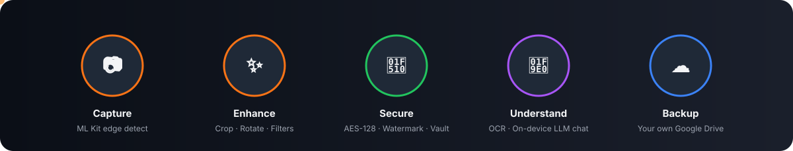
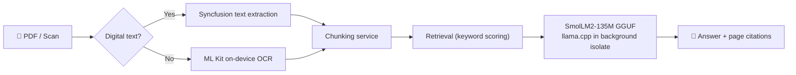
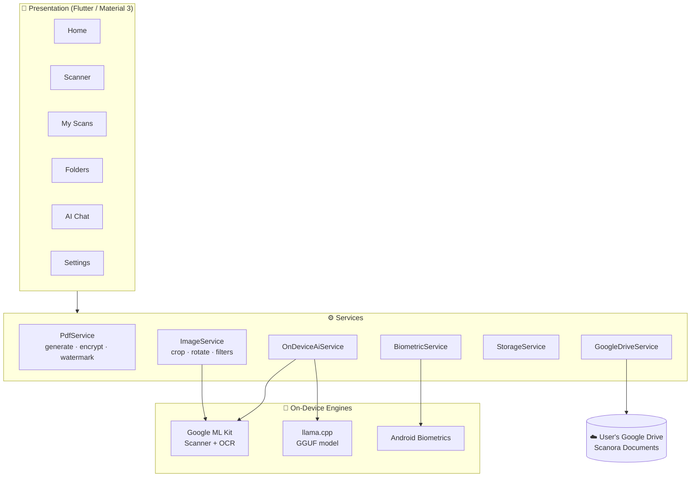

<div align="center">



<br/>

<a href="https://github.com/jawaanquizziz/Scanora">
  
</a>

<br/>

[](https://flutter.dev)
[](https://dart.dev)
[](#-installation)
[](#-on-device-ai-document-assistant)
[](#-installation)

[](https://developers.google.com/ml-kit)
[](https://github.com/ggerganov/llama.cpp)
[](https://pub.dev/packages/syncfusion_flutter_pdf)
[](https://developers.google.com/drive)
[](https://firebase.google.com)


**[✨ Features](#-features) • [📱 Screenshots](#-screenshots) • [🏗️ Architecture](#%EF%B8%8F-architecture) • [🧰 Tech Stack](#-tech-stack) • [⚡ Installation](#-installation) • [🚀 Roadmap](#-future-scope)**

</div>

---

## 📖 About

**Scanora** is a privacy-first, AI-powered mobile document scanner built with **Flutter**.

Most scanner apps lock basic features behind subscriptions, and most "chat with PDF" tools upload your private documents — Aadhaar, PAN, bank statements, contracts, medical reports — to someone else's server. **Scanora does everything on your phone.** Capture, enhancement, OCR, PDF encryption, watermarking and even the **LLM-powered document assistant** all run locally. Cloud backup is optional and goes straight into **your own Google Drive**.

> [!IMPORTANT]
> **Your documents never leave your device** unless *you* choose to back them up to your personal Google Drive.

<div align="center">
  
</div>

---

## ✨ Features

<table>
<tr>
<td width="50%" valign="top">

### 📷 Smart Scanning
- **Auto edge detection** via Google ML Kit Document Scanner
- **Manual 4-point perspective crop** & rotate
- **Multi-page** capture + **gallery import**
- Live filters: **Original · Enhance · Grayscale · B&W**
- Export as **A4** or **US Letter** PDF

</td>
<td width="50%" valign="top">

### 🧠 On-Device AI Assistant
- Chat with any PDF — **fully offline**
- Local **GGUF LLM** (SmolLM2-135M Instruct) via `llama.cpp`
- Hybrid text extraction: **digital PDF text + ML Kit OCR**
- Chunking + retrieval with **source citations** to the page
- One-tap: **Summarize · Action items · Dates & amounts**

</td>
</tr>
<tr>
<td width="50%" valign="top">

### 🔐 Triple-Layer Security
- **AES-128 PDF password lock** (separate user/owner keys)
- **Anti-fraud diagonal watermarks** — `CONFIDENTIAL`, `FOR KYC ONLY`, `DO NOT COPY`, `DRAFT` or custom
- **Biometric app lock** (fingerprint / face / PIN)
- **Vault folders** that require biometrics to open

</td>
<td width="50%" valign="top">

### ☁️ Organize & Backup
- Color-coded **folders**, favorites, search & sort
- Built-in **PDF viewer**, print & native **share**
- **Google Sign-In** + **Drive API v3** backup into a
  `Scanora Documents` folder in *your* Drive
- **Auto-sync** new scans · Light / Dark / System theme

</td>
</tr>
</table>

---

## 📱 Screenshots

<div align="center">

| Home | Scanner Review | Save & Secure |
|:---:|:---:|:---:|
|  |  |  |
| **AI Document Chat** | **Folders & Vault** | **Settings & Cloud Backup** |
|  |  |  |

<br/>


<sub>▶️ Scan → enhance → lock with password → chat with the PDF</sub>

</div>

---

## 🔐 Security Deep-Dive

| Layer | What it does | How |
|:--|:--|:--|
| 🛡️ **Anti-Fraud Watermark** | Stamps a translucent diagonal label on every page so a submitted ID scan can't be reused elsewhere | Syncfusion PDF graphics layer, rotated text stamp |
| 🔒 **PDF Password** | File stays locked even when shared via WhatsApp / email / Drive | AES-128 encryption with distinct user & owner passwords |
| 👆 **Biometric Lock** | Locks the whole app and individual vault folders | Android BiometricPrompt via `local_auth` |
| 📦 **Local-first storage** | No third-party servers ever touch your files | App sandbox + optional *personal* Google Drive |

---

## 🧠 On-Device AI Document Assistant



- 🚫 **No API keys, no internet, no data upload**
- ⚙️ Inference runs in a **background isolate** so the UI stays smooth
- 📚 Every answer links back to the **source page** in the PDF
- 🔓 Works on **password-protected PDFs** too (decrypted locally for reading)

---

## 🏗️ Architecture



<details>
<summary><b>📂 Project structure</b> (click to expand)</summary>

```text
lib/
├── app.dart / main.dart
├── core/
│   ├── theme/            # AppColors, AppTheme (light/dark)
│   ├── utils/            # date & file helpers
│   └── widgets/          # dialogs, thumbnails, loaders, logo
├── features/
│   ├── splash/           # animated splash
│   ├── shell/            # bottom nav + biometric lock overlay
│   ├── home/             # dashboard & quick actions
│   ├── scanner/          # capture, crop, filters, review, save dialog
│   ├── documents/        # My Scans list + PDF viewer
│   ├── folders/          # folders & biometric vaults
│   ├── chat/             # AI chat: extraction, chunking, retrieval, LLM providers
│   └── settings/         # theme, security defaults, Google Drive
├── models/               # ScannedDocument, DocumentFolder, ScanPage, AppSettings
└── services/             # pdf, image, storage, biometric, google_drive, thumbnails
```

</details>

---

## 🧰 Tech Stack

<div align="center">


</div>

<br/>

| Layer | Technologies |
|:--|:--|
| **Framework** | Flutter 3.x · Dart 3.12 (AOT-compiled to native ARM) · Material 3 · Google Fonts |
| **Computer Vision** | `google_mlkit_document_scanner` · `google_mlkit_text_recognition` · `image_picker` |
| **On-Device AI** | `llama_cpp_dart` (llama.cpp FFI) · SmolLM2-135M Instruct **GGUF** (Q4_K_M) · custom chunking & retrieval |
| **Image Processing** | `image` (crop, rotate, contrast, grayscale, threshold) |
| **PDF** | `pdf` · `printing` · `syncfusion_flutter_pdf` (AES encryption, watermark, text extraction) |
| **Security** | `local_auth` (fingerprint / face / PIN) |
| **Cloud** | `google_sign_in` (OAuth 2.0) · Firebase Google Services · Google Drive REST API v3 via `http` |
| **Storage & OS** | `shared_preferences` · `path_provider` · `share_plus` · `intl` |
| **Build** | Gradle Kotlin DSL · Java 17 · split-per-ABI release APKs (~20 MB) |

---

## ⚡ Installation

### 📥 Option 1 — Just install the app

1. Download **`Scanora-Release.apk`** from the [**Releases**](https://github.com/jawaanquizziz/Scanora/releases) page.
2. On your phone, allow **Install unknown apps** for your browser / file manager.
3. Open the APK → **Install** → enjoy. 🎉

> [!TIP]
> Most phones from 2017+ are 64-bit — use `app-arm64-v8a-release.apk`. For very old phones use `app-armeabi-v7a-release.apk`.

### 🛠️ Option 2 — Build from source

```bash
# 1. Clone
git clone https://github.com/jawaanquizziz/Scanora.git
cd Scanora

# 2. Get packages
flutter pub get

# 3. Run on a connected device
flutter run

# 4. Build small release APKs (~20 MB each)
flutter build apk --release --split-per-abi
```

<details>
<summary><b>☁️ Enable Google Drive backup (for your own fork)</b></summary>

1. Create a Firebase project and add an Android app with package **`com.scanora.app.scanora`**.
2. Add your signing **SHA-1** (`cd android && ./gradlew signingReport`).
3. Enable **Google** sign-in in Firebase Auth and download **`google-services.json`** into `android/app/`.
4. In Google Cloud Console, **enable the Google Drive API** for the same project.
5. Under **OAuth consent screen → Audience**, add your Gmail as a **Test user** (or publish the app).

</details>

<details>
<summary><b>🧠 On-device AI model</b></summary>

The AI assistant uses a small quantized **GGUF** model (SmolLM2-135M Instruct, Q4_K_M, ~100 MB). The app downloads it on first use with a progress dialog and stores it locally — after that, chat works with **zero internet**.

</details>

---

## 🆚 Why Scanora?

| | Typical scanner apps | Cloud "chat with PDF" tools | **Scanora** |
|:--|:--:|:--:|:--:|
| Free, clean PDFs (no watermark ads) | ❌ | — | ✅ |
| AI summaries & Q&A | 💰 Paid / cloud | ☁️ Uploads your file | ✅ **Offline** |
| AES password-locked PDFs | 💰 | ❌ | ✅ |
| Anti-fraud KYC watermarks | 💰 | ❌ | ✅ |
| Biometric vault | Limited | ❌ | ✅ |
| Where your files live | Vendor cloud | Vendor server | **Your phone / your Drive** |

---

## 🚀 Future Scope

- [ ] 🌏 **Indian regional languages & handwriting OCR** (Hindi, Marathi, Tamil, Telugu…)
- [ ] ✍️ **Digital e-signatures** & PDF form filling
- [ ] 📚 **Multi-document Q&A** with an on-device vector index
- [ ] 🧾 **Auto-categorization** & invoice-to-Excel/CSV extraction
- [ ] 🍎 **iOS, Windows & macOS** builds from the same Flutter codebase
- [ ] 🎙️ **Voice interaction** — offline speech-to-text & read-aloud

---

## 🤝 Contributing

Contributions, issues and feature requests are welcome!

1. Fork the repo
2. Create your branch: `git checkout -b feature/amazing-feature`
3. Commit: `git commit -m "feat: add amazing feature"`
4. Push: `git push origin feature/amazing-feature`
5. Open a Pull Request 🚀

---

<div align="center">

### 💛 If Scanora helped you, drop a ⭐ on the repo!

Made with ❤️ and Flutter by **[Jawaan](https://github.com/jawaanquizziz)**


</div>
